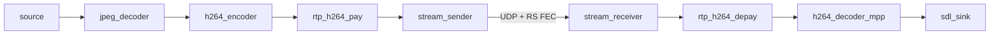

# VStreamer

VStreamer is a C++17 library of independent video **components** (sources, coders, sinks) and
the bench apps that wire them into a low-latency H.264-over-UDP path with Reed–Solomon FEC.
The target is a rover camera (UVC → H.264 → radio) and a ground-station viewer (radio → decode
→ display). Today the loopback bench binary `stream_sdl_test` runs both ends in one process over loopback.

This page describes the code as it is. Designed-but-not-built pieces (feedback plugin, config
loader, core console, rover/winject wiring) are listed under
[Roadmap / target design](#roadmap--target-design).



## Component model

All interfaces live in `src/core/`.

| Interface | Header | Data path |
|-----------|--------|-----------|
| `component` | [component.hpp](../src/core/component.hpp) | `configure(key, value)` / `query(key, &value)` |
| `component_source` | [component_source.hpp](../src/core/component_source.hpp) | `output(component_pdu&)` |
| `component_coder` | [component_coder.hpp](../src/core/component_coder.hpp) | `input(component_pdu&&)` + `output(component_pdu&)` |
| `component_sink` | [component_sink.hpp](../src/core/component_sink.hpp) | `input(component_pdu&&)` |

Concrete components inherit `component_input` / `component_output` (or both via
`component_coder`). Port indices live on each PDU (`port`); caps are advertised through
`input_ports()` / `output_ports()` (`port_desc` + `sdu_type_e`).

**Return codes.** `0` on success, negative errno otherwise. `output()` returns `-EAGAIN` when
nothing is ready; apps poll or wait on `pdu_wakeup` from `component::set_wakeup()`.

### `configure` / `query` contract

```cpp
/* 0 on success, -ENOTSUP unknown key, -EINVAL bad value, other -errno. */
virtual int configure(std::string_view key, std::string_view value) = 0;
/* Fills *value (overwritten). 0 / -ENOTSUP / -EINVAL. Thread-safe. */
virtual int query(std::string_view key, std::string *value) const = 0;
```

- Keys and values are strings. Integers are decimal (`key_parse_i64`: no `+`, no octal/hex),
  except V4L2 control ids, which also accept `0x…`.
- Unknown key → `-ENOTSUP`, bad value → `-EINVAL`, key only valid before `open()` → `-EBUSY`.
  `tests/component_contract_test.cpp` checks the unknown-key rule on every built component.
- `configure` may be called from another thread (e.g. a console) while the pipeline runs;
  each component locks internally. Keys marked *live* below take effect without reopening.

### `component_pdu` and buffers

Wires carry `component_pdu` ([component_pdu.hpp](../src/core/component_pdu.hpp)): SDU bytes in
`bfc::shared_sized_buffer` (from [bfc](https://github.com/therooftopprinz/bfc)),
`sdu_type_e` (e.g. `NV12`, `H264_AU`, `STREAM_DGRAM`, `RTP`), `ts_us`, `seq`, and `flags`
(`pdu_flag_e::KEY`, `AU_END`, …). Caps PDUs embed `video_raw_caps` / `video_coded_caps` via
`make_caps_pdu()`.

**Immutability rule:** once a PDU is passed to `input()` or returned from `output()`, treat its
SDU as read-only unless this stage holds the only buffer reference. Components recycle storage
through `buffer_pool`.

Wire layout of the forward datagram: [packet-model.md](packet-model.md).

### Node independence

Each component validates only its own limits and formats. It never includes another
component's header or assumes what sits upstream or downstream. Link-specific values (radio MPDU
size, MTU) belong to the **pipeline creator** (today `stream_sdl`). Components expose their
limits through `query()` — e.g. `stream_sender` `max_input` — and the creator configures the
neighbours to match. The two ends of one wire protocol (`stream_sender`/`stream_receiver`,
`rtp_h264_pay`/`rtp_h264_depay`) share that protocol's header in `core/` and nothing else.

## Components

Create by type, or by name through `component_factory::create_source/create_coder/create_sink`
([component_factory.cpp](../src/core/component_factory.cpp)). A factory call for a component that
is not built returns `nullptr`.

| Component | Kind | In → out | Factory names | Build option |
|-----------|------|----------|---------------|--------------|
| `noise_source` | source | → NV12 | `noise`, `noise_source` | `ENABLE_NOISE_SOURCE` |
| `v4l2_source` | source | → MJPEG | `v4l2`, `v4l2_source` | `ENABLE_V4L2_SOURCE` |
| `stream_receiver` | source | UDP → SOCK | `stream_receiver`, `stream`, `stream_source` | `ENABLE_STREAM_RECEIVER` |
| `jpeg_decoder_multicore` | coder | MJPEG → NV12 | `jpeg_decoder_multicore`, `jpeg_decoder` | `ENABLE_JPEG_DECODER_MULTICORE` |
| `h264_encoder_mpp` | coder | NV12 → H264 | `h264_encoder_mpp`, `h264_encoder` | `ENABLE_H264_ENCODER_MPP` |
| `h264_encoder_cedar` | coder | NV12 → H264 | `h264_encoder_cedar`, `h264_encoder`¹ | `ENABLE_H264_ENCODER_CEDAR` |
| `h264_encoder_intel` | coder | NV12 → H264 | `h264_encoder_intel`, `h264_encoder`¹ | `ENABLE_H264_ENCODER_INTEL` |
| `esp32_h264_isp_ng_src` | source | CSI / ISP → H264 | `esp32_h264_isp_ng_src` | ESP-IDF, esp32p4 target |
| `esp32_h264_isp_src` | source | CSI / ISP → H264 | `esp32_h264_isp_src` (legacy wrapper) | ESP-IDF, esp32p4 target |
| `h264_encoder_esp32p4` | coder | O_UYY_E_VYY → H264 | `h264_encoder_esp32p4`, `h264_encoder`³ | ESP-IDF, esp32p4 target |
| `h264_decoder_mpp` | coder | H264 → NV12 | `h264_decoder_mpp`, `h264_decoder` | `ENABLE_H264_DECODER_MPP` |
| `rtp_h264_pay` | coder | H264 FRAME → SOCK | `rtp_h264_pay`, `rtp_pay` | `ENABLE_RTP_H264_PAY` |
| `rtp_h264_depay` | coder | SOCK → H264 FRAME | `rtp_h264_depay`, `rtp_depay` | `ENABLE_RTP_H264_DEPAY` |
| `stream_sender` | sink | SOCK or RTP → UDP | `stream_sender`, `stream_sink` | `ENABLE_STREAM_SENDER` |
| `mkv_sink` | sink | MJPEG / H.264 → .mkv | `mkv`, `mkv_sink` | `ENABLE_MKV_SINK` |
| `sdl_sink` | sink | NV12 → window | `sdl`, `sdl_sink`, `display`, `sdl_kmsdrm`² | `ENABLE_SDL_SINK` |

¹ `h264_encoder` picks the first built of MPP, Cedar, Intel.
² `sdl_kmsdrm`, `sdl_kmsdrm_sink`, `kmsdrm_sink` return an `sdl_sink` with `video_driver=kmsdrm`.
³ Only built by the ESP-IDF component, where it is the only encoder.

### Keys

Generated from each component's `configure` / `query`. **C** = configure, **Q** = query.
`size` is `WxH`.

**`noise_source`** — synthetic NV12, bandwidth-shaped spectrum → SIMD IFFT (PFFFT, OpenMP).

| Key | C/Q | Values / default |
|-----|-----|------------------|
| `size`, `fps` | C Q | default `416x240`, `30` (fps 1..240) |
| `format` | C Q | `nv12` only |
| `noise-bandwidth` (`noise_bandwidth`, `noise-randomness`) | C Q | 0..100 (0 = flat gray) |
| `noise-block-size` (`noise_block_size`) | C Q | 0..256, legacy no-op |
| `pregenerate-frames` (`_frames`, `-frame`) | C Q | 0..128 frames looped (0 = live) |
| `state` | Q | `running` or `pregeneration_i/N` |
| `status`, `device`, `width`, `height`, `pixel_type`, `media_type`, `noise-fft-grid`, `noise-fft-simd`, `noise-internal-size`, `noise-luma-block-size` | Q | informational |

**`v4l2_source`** — UVC MJPEG mmap capture.

| Key | C/Q | Values / default |
|-----|-----|------------------|
| `device` | C Q | default `/dev/video0` |
| `format` | C Q | `mjpeg` (`mjpg`) only |
| `size`, `fps` | C Q | default `1280x720`, `30` |
| `ctrl.<id>` | C Q | V4L2 control by id (decimal or `0x…`), live |
| `v4l2-ctl/<name>` | C Q | V4L2 control by `v4l2-ctl --list-ctrls` name, live |
| `v4l2-ctl` | Q | all readable `name=val` |
| `state` | Q | `capturing` / `waiting_device` |
| `status` | Q | `live WxH fps` / `waiting_device` |
| `width`, `height`, `media_type` | Q | informational |

Controls set before `open()` are stashed and applied after STREAMON. Noise fallback when the
camera disappears is pipeline-creator policy (`camera_noise_mux_source` in the bench app), not
part of `v4l2_source`.

**`jpeg_decoder_multicore`** — libav MJPEG → NV12 on N CPU workers, in-order results.

| Key | C/Q | Values / default |
|-----|-----|------------------|
| `size`, `fps` | C Q | default `1280x720`, `30` |
| `workers` | C Q | 1..8, default 2; before `open()` (`-EBUSY`) |
| `worker_cpu` | C | pin all workers to one CPU (−1 = none) |
| `worker_cpus` | C | comma list, assigned to workers round-robin |
| `output_mode` | C Q | `filter` / `convert` |
| `output_format` (`format`) | C Q | `nv12` |
| `decoded_pix_fmt`, `status` | Q | informational |

**`h264_encoder_mpp`** — Rockchip MPP (RK3588). Lock order `mu` → `mpp_api_mu`.

| Key | C/Q | Values / default |
|-----|-----|------------------|
| `size`, `fps` | C Q | default `1920x1080`, `30` (fps 1..120); reopens encoder |
| `qp` | C Q | 2..51, default 36, live |
| `gop` | C Q | 1..255, default 30, live |
| `rc` | C Q | `cbr` / `fixqp`, live |
| `cbr` (`bps`) | C Q | bit/s 0..200 000 000, default 20 000 000, live in `cbr` mode |
| `super_i_ratio`, `super_p_ratio` | C | ≥ 0, defaults 6.0 / 1.5 |
| `idr` | C | request IDR on the next frame |
| `latency_ms` | Q | capture → encoded AU |
| `backend`, `status` | Q | informational |

**`h264_encoder_cedar`** (libav `h264_cedrus`, width multiple of 32) and
**`h264_encoder_intel`** (libav `h264_vaapi`): `size`, `fps` (1..120), `qp` (Cedar 2..47,
Intel 0..52), `gop` (1..255), `idr`; Intel adds `device` (VA render node). Query adds `backend`,
`status`.

**`h264_encoder_esp32p4`** — ESP32-P4 hardware H.264 (`esp_h264`). Input is `O_UYY_E_VYY`, the
packed YUV 4:2:0 the P4 ISP writes (w × h × 3/2 bytes; line pairs U Y Y … / V Y Y …); the encoder
cannot read NV12. Encoding is synchronous in `input()`: ~34 ms per 1080p frame on the pipeline
thread. Raw caps must match `size`. Constrained Baseline; IDR AUs carry `KEY`.

| Key | C/Q | Values / default |
|-----|-----|------------------|
| `size` | C Q | 80..1920 × 80..2032, both even, default `1920x1080`; reopens the encoder |
| `fps` | C Q | 1..120, default 30, live |
| `gop` | C Q | 1..255, default 30, live |
| `bitrate` (`bps`) | C Q | 10 000..100 000 000, default 4 000 000, live |
| `qp_min`, `qp_max` | C Q | 0..51, defaults 20 / 40; reopens the encoder |
| `idr` | C | IDR on the next frame |
| `encode_ms` | Q | last / max encode time |
| `stats`, `status`, `backend` | Q | informational |

**`h264_decoder_mpp`** — Rockchip MPP H.264 → NV12. Lock order `mu` → `mpp_io_mu`.

| Key | C/Q | Values / default |
|-----|-----|------------------|
| `size`, `fps` | C Q | default `1280x720`, `30` |
| `output_mode` | C Q | `filter` / `convert` |
| `output_format` (`format`) | C Q | `nv12` |
| `output_size_mode` | C | `stream` (use SPS size) / `config` (use `size`) |
| `show_corrupt` | C Q | `off` (default: drop frames MPP flags with errinfo, i.e. freeze until the next IDR after a loss) / `on` (show them with artifacts; discarded frames are still dropped) |
| `corrupt_frames` | Q | errinfo frames since open, shown or dropped |
| `latency_ms`, `status` | Q | informational |

**`rtp_h264_pay`** — H.264 AU → RTP datagrams (PT 96, SSRC `0xC0DE0001`, single NAL / STAP-A /
FU-A, capture-time header extension).

| Key | C/Q | Values / default |
|-----|-----|------------------|
| `mtu` | C | 31..65507, default 1400 |
| `fps` | C | 1..120, default 30 (90 kHz timestamps) |
| `datagrams_dropped`, `pool_misses` | Q | counters |

**`rtp_h264_depay`** — RTP → H.264 AU.

| Key | C/Q | Values / default |
|-----|-----|------------------|
| `fps` | C | 1..120, default 30 |
| `au_dropped`, `nal_dropped`, `loss`, `need_idr`, `rtp_reordered` | Q | counters |
| `capture_ts_rejected`, `capture_skew_ms` | Q | wire capture-time validation (diagnostic) |

**`stream_sender`** — UDP egress with RS block-erasure FEC and a bounded queue. No rate control:
the send queue holds at most 1024 packets; `input()` returns `-EAGAIN` when it cannot take every
packet the SDU can produce (all n shards of a block it completes), counted in `queue_full_rejects`. Threads:
`input()` (caller), the send thread, the host's named default or CV reactor for reverse
telemetry, and `configure()`. Lock order `mu` → `fec_mu`.

| Key | C/Q | Values / default |
|-----|-----|------------------|
| `udp_transport` | C Q | UDP destination `host:port` (hostnames resolved at `open()`) |
| `telemetry` | C Q | `on` / `off` (default `on`), before `open()` only |
| `queue_transport_tx` | C Q | Registered outgoing wire-datagram queue name; requires `queue_transport_rx`. Mutually exclusive with `udp_transport`. |
| `queue_transport_rx` | C Q | Registered incoming reverse-report queue name; requires `queue_transport_tx`. |
| `reactor` | C Q | Registered reactor name. UDP resolves vstreamer's `default_reactor_registry`; queue mode resolves BFC's `cv_reactor_registry`. Required in both modes, including when telemetry is off. Host-owned reactors must run until the sender closes; close only detaches this sender. |
| `max_datagram` | Q | fixed 1476-byte UDP payload ceiling (winject MPDU path) |
| `max_input` | Q | largest `input()` SDU for this ceiling: `max_datagram` − 6 (parity header and coded length), the same for every k/n and for `fec none` |
| `fec` | C | `block` (`RS_BLOCK_ERASURE`, default) / `none` (k = n = 1), live |
| `fec` | C | `block` (RS FEC) or `none` (raw SDU path, no RS k=n=1) |
| `fec_k`, `fec_n` | C Q | 1 ≤ k ≤ 31, k ≤ n, n − k ≤ 31, default 10 / 12, live (the open block is flushed; the data sequence keeps counting) |
| `fec_spread_ms` | C Q | 0..250, default 0. Data shards always leave at once; parity row j of a block of c shards leaves at the later of t0 + (k + j) × spread / c (t0 = its first data shard) and close + j × spread / c (close = its last data shard), so a burst-filled block spreads its parity over the window and parity never leaves in a lump. Blocks overlap on the wire. Capped at 250: the receiver assumes that spread until it has measured one. The receiver measures the spread from arrival times and sets each block's deadline from it (see `stream_receiver`). Each shard leaves at its release time; a send thread that fell behind sends the shards already due back to back until it is on schedule again. `send_late_max_ms` shows how late datagrams left. Shards wait in the send queue until due and count against its fixed 1024-packet capacity. Lowering it pulls already-queued shards in to the new spread. On the ESP32-P4 the PIE FEC encoder (`CONFIG_VSTREAMER_RS_PIE`, default on) sends parity in tighter bursts that compete with the H.264 encoder for PSRAM: about 1 encoder fps lost at spread 0, 0.1–0.3 fps at 25 ms or more |
| `send_cpu`, `send_prio` | C Q | send-thread placement, see Threading |
| `pkt_sent`, `byt_sent` | Q | `ts,udp,fec` cumulative packets/bytes; monotonic milliseconds |
| `peer_udp_pkt_recv`, `peer_fec_pkt_recv` | Q | `ts,rcv,gap` from the last receiver report; `-ENODATA` before one arrives |
| `peer_byt_recv` | Q | `ts,udp,fec` byte totals from the receiver report; `-ENODATA` for legacy reports without bytes |
| `peer_udp_packet_received`, `peer_fec_packet_received`, `peer_udp_gap_count`, `peer_fec_gap_count`, `peer_report_age_ms`, `peer_report_interval_ms`, `peer_reports_received`, `peer_reports_lost`, `peer_reports_rejected`, `peer_session` | Q | last reverse link report (when telemetry received one) |
| `fec_mode`, `stats`, `dropped`, `queue_full_rejects`, `queue_evicted`, `fec_oversized`, `pool_misses`, `queue_packets`, `queue_bytes`, `transport_dropped` | Q | state / counters |
| `send_late_max_ms` | Q | largest delay of a datagram past its release time since the previous query |

`stream_sender` transmits data delivered to it while open. The controller owns data delivery policy.

Queue transport setup (before `open()`):
register two distinct, nonzero-capacity `stream_transport_queue` instances using
`stream_transport_queue_registry` from `core/stream_queue_transport.hpp`.
These are BFC reactive circular lossy queues of `bfc::shared_sized_buffer`;
each entry contains one complete wire packet (one FEC shard, header included).
Set `queue_transport_tx` and `queue_transport_rx` to their registry names.
The host owns capacity and queue lifetime. A full queue evicts its oldest packet;
the sender's wire counters count packets submitted to the transport, not peer delivery;
`query("transport_dropped")` counts the packets a full TX queue evicted.
`query("queue_evicted")` counts send-queue packets evicted to make room for a forced push,
such as a reconfigure flush (one count per packet, also included in `dropped`); input itself
never evicts.

UDP hosts register a `vstreamer::default_reactor` in `vstreamer::default_reactor_registry`
and configure its name with `reactor`. Applications can use `default_reactor_host`
from `core/default_reactor_host.hpp` to own a running registered reactor; declare it
before its senders and configure each sender with its `name()`. The vstreamer app
supplies a shared host reactor to its sender nodes.

Register the shared `bfc::cv_reactor<>` in `bfc::cv_reactor_registry` and select
it with `reactor`. The sender registers its RX handler there and wakes it after
TX pushes; register the target's TX-queue consumer on that same reactor.
A peer pushing reverse reports must also wake the reactor. Read handlers must
drain their queues. Each queue has one consumer. Closing the sender detaches its
RX handler, waits for in-flight callbacks, and leaves the host's reactor and
queued packets intact.

Transport keys and `reactor` can only change while closed (`-EBUSY` otherwise).
Clear the selected transport's value(s) before switching modes. Mixing modes,
an incomplete pair, zero capacities, or using the same queue in both directions
fails with `-EINVAL`; both modes require a named `reactor`, including when telemetry is off. Missing registered queues/reactors fail with `-ENOENT`.
The former sender keys `stream` and `reactor_name` are removed.

**`stream_receiver`** — UDP ingress, strips the shard header, FEC-decodes and re-orders, outputs
one `STREAM_DGRAM` PDU per original datagram.

| Key | C/Q | Values / default |
|-----|-----|------------------|
| `listen` | C Q | bind `host:port` |
| `telemetry` | C Q | `on` / `off` (default `on`), live |
| `telemetry_ms` | C Q | 20..5000, default 100, live |
| `telemetry_sent`, `telemetry_send_errors`, `telemetry_peer`, `telemetry_peer_changes`, `session_id`, `rx_bad_header` | Q | reverse-path telemetry; `rx_bad_header` counts dropped invalid shard headers |
| `max_datagram` | C Q | 64..65507, default 1472; before `open()` |
| `recv_cpu`, `recv_prio` | C Q | thread placement, see Threading |
| `udp_pkt_recv`, `fec_pkt_recv` | Q | `ts,rcv,gap` cumulative packets and gaps; monotonic milliseconds |
| `byt_recv` | Q | `ts,udp,fec` cumulative bytes; monotonic milliseconds |
| `udp_packet_received`, `udp_gap_count` | Q | wire counters (pre-FEC) |
| `fec_packet_received`, `fec_gap_count` | Q | post-FEC counters |
| `fec_recovered`, `fec_failures`, `fec_rs_failures`, `fec_missing_shards`, `fec_evicted_blocks`, `fec_given_up_blocks`, `fec_late_blocks`, `fec_new_references`, `fec_hdr_errors`, `fec_kn_mismatch`, `rx_oversize`, `rx_truncated`, `pool_misses`, `out_rate`, `stats` | Q | counters |
| `fec_spread_est_ms`, `fec_jitter_est_ms` | Q | sender spread (from the parity row gap) and arrival jitter measured from receive times (spread = 250 until two blocks are fitted). A hole is given up when its block's last parity is due under the sender's release rule, from that block's own fill time, plus a jitter margin |

In-process input: `set_datagram_transport(receive, send)` (before `open()`) replaces the listen
socket. `receive` returns the next wire datagram or nothing and must not block; the receive
thread drains up to 64 per pass and polls about every millisecond. `send` takes each reverse
link report. Received datagrams are kept as views, not copied. Embedded builds can raise the
deadline margin floor with `VSTREAMER_RX_DEADLINE_MARGIN_MIN_MS` (5..100, default 5) and put
FEC decode rows in PSRAM with `CONFIG_VSTREAMER_RX_PSRAM`.

Stream metrics use the eight tuple queries above. Each value contains three decimal integers,
with no spaces. Reads do not reset counters. UDP totals count valid stream transport datagrams
and their complete wire payload bytes, including the shard headers, padding and
parity; they exclude IP/UDP headers and reverse reports. Queue transport sender totals count
submissions, including packets later evicted by the host queue. FEC send totals count payload
SDUs accepted before encapsulation; receive totals count payloads after reconstruction, before
downstream consumption. With `fec=none`, both layers count the same payload packets, while UDP
bytes additionally include the shard headers. Sender local totals accumulate for the object's
lifetime; receiver packet and byte totals reset on `open()`, identified by `session_id`.

Each tuple is sampled under its component's metrics lock. Local timestamps are sampled with
the counters; all peer timestamps use the receiver's report timestamp divided by 1000.
Separate queries can cross samples or reports, even within the same millisecond. For peer loss
calculations, bracket the packet queries with unchanged `peer_reports_received` and
`peer_session` values and require equal timestamps. Reset delta windows on session changes or
counter rollback. Use tuple timestamp deltas for rates; retain the last valid metric and rate
baseline when queries fail. The app uses this interface; no public atomic-counter references or
typed metrics snapshots remain. Legacy scalar counter query names remain compatible for
existing scripts and consoles; `stats` retains its existing format.

Receivers send a versioned 64-byte report payload (68 bytes with the stream header), including
UDP and FEC byte totals. New senders also accept the legacy 44-byte payload, but return
`-ENODATA` for `peer_byt_recv` for those reports. Old senders reject the new payload length;
upgrade both ends to obtain current telemetry. Unknown versions and invalid reserved bits are
rejected. See [packet model](packet-model.md) for the wire layout.

FEC receive sequencing (`rs_block_erasure`). One reference, the next data sequence number to
deliver:

| Data shard vs reference | Action |
|---|---|
| behind by ≤ 128 | late: kept for decoding only (`fec_late_blocks`) |
| behind by > 128, or ahead by > 1024 | new reference: a new sender session; old state dropped (`fec_new_references`) |
| ahead by ≤ 1024 | same session; sequence numbers in between are waited for |

Parity of a block that ended more than 128 behind the reference is dropped as late: spread
parity trails its block, so only data starts a new reference from behind. Parity for a block
already done (all parity in, or quiet for 250 ms) is dropped too.

Data shards in sequence go out at once; a hole waits for its block's parity and goes out when FEC
recovers it. A hole that cannot be recovered is given up at its deadline (`fec_given_up_blocks`,
one per block; a run of holes with no known block counts once). Deadlines come only from receive
times and the sender's release rule: parity row j of a block of c shards leaves at the later of
first + (k + j) × spread / c and close + j × spread / c. Each finished block's parity arrivals are
fitted against row (median of pairwise slopes, so one late shard does not skew it), which gives
the spread; the last row's offset from the rule gives a bias and, with the fit residual, the
jitter. Two blocks give the first estimate; later blocks update it weighted by how much of their
parity they had. A hole's deadline is when its block's last parity is due, from that block's own
first and last data arrivals (an unknown start is taken as a burst: the longest wait), plus the
bias and a margin (3 × jitter, at least 5 ms). Holes past the newest block with parity are placed
in blocks of the stream's steady k, so a short block flushed on reconfigure does not cut the next
block's wait. Before an estimate the wait is 250 ms after the block's close. A stream with no
parity gives up a hole as soon as later data shows the sender is past it. A restarted sender
landing within 128 behind the reference is read as late until its sequence numbers pass it (odds
128 / 65536 per restart).

**`mkv_sink`** — MJPEG or H.264 (Annex-B AUs) → Matroska through `core/mkv_writer` (stdio, no
libav). Clusters of ~1 s start on keyframes and are flushed and fsync'ed as they close; the
Segment is written with unknown size, so a file cut off by power loss plays up to the last closed
cluster. Sizes, Duration and Cues are filled in on stop. H.264 recording starts at the first
keyframe with SPS and PPS (earlier AUs count as `skipped`); a codec or size change starts a new
segment.

| Key | C/Q | Values |
|-----|-----|--------|
| `output` | C Q | path template (empty = stop recording) |
| `size`, `fps` | C | stream parameters |
| `mux_cpu`, `mux_prio` | C Q | thread placement, see Threading |
| `segment`, `stats`, `skipped`, `dropped`, `write_errors` | Q | informational; a write error closes the segment and the next frame starts a new one |

**`sdl_sink`** — NV12 preview through `sdl_nv12_presenter`. `input()` creates rendering
resources on the first frame and presents on the calling rendering thread; with vsync each
call can block for up to one display refresh. Configure dimensions before sending frames
without caps. Dimension configuration only stores settings and never creates SDL resources;
received caps take precedence. Keep presentation on the rendering thread, including KMSDRM.

| Key | C/Q | Values |
|-----|-----|--------|
| `width`, `height` | C Q | fallback NV12 dimensions, even integers 2..16384; default unset (0) |
| `render_thread` | Q | recorded rendering thread ID as a string, empty before resource creation or after close |
| `title` | C | window title, live |
| `video_driver` | C Q | `auto` (default; SDL decides), `kmsdrm`, or any SDL driver name; before `open()` |
| `stats` | Q | informational |

## Threading

Components do not start pipeline threads; the app does. Threads inside components:

| Component | Internal threads | Placement keys |
|-----------|------------------|----------------|
| `stream_sender` | send thread (pacing, FEC flush timer); host-owned named reactor handles telemetry | `send_*` |
| `stream_receiver` | receive thread (poll, FEC decode, reverse telemetry `sendto`) | `recv_*` |
| `mkv_sink` | mux thread (`mkv_writer` file I/O) | `mux_*` |
| `esp32p4_csi_camera_src` | capture thread | `capture_*` |
| `esp32_h264_isp_ng_src` | one worker: camera dequeue + synchronous encode | `encode_*` |
| `esp32_h264_isp_src` | encode thread (+ its camera's capture thread) | `encode_*`, `capture_*` |
| `jpeg_decoder_multicore` | `workers` decode threads | `worker_cpu`, `worker_cpus` |
| `noise_source` | pregenerate worker (when `pregenerate-frames > 0`) | — |

**Placement is the app's decision.** A component never picks a core or priority itself; it takes
`<role>_cpu` (−1 = any core) and `<role>_prio` (FreeRTOS priority, −1 = pthread default; ignored
on Linux), both default −1, and starts the thread with them in `open()`
(`core/thread_spawn.hpp`: `thread_place`, `spawn_thread`). They can be set only while the component
is closed (`-EBUSY` while open: ESP-IDF cannot move a running task to another core), so whoever
configures the nodes stops them first. On Linux the new thread is pinned before it runs and
threads it starts inherit the pin; the pipeline thread (`set_cpu`) is pinned only after its nodes
are open. The ESP32-P4 live TX layout is at the top of `idf/vstreamer/src/live_tx.cpp`:
the FEC encode (`vs_isp_tx`) has core 0 with capture, and the send thread is on core 1, since
sharing a core with the ~10 ms-per-block encode starved it and spread blocks left in lumps.

Lock-order rules are stated next to the mutexes in each header (`stream_sender`,
`h264_encoder_mpp`, `h264_decoder_mpp`). Shutdown order everywhere: signal → join → close.
MPP codecs cancel pending I/O privately inside `close()`. The loopback app joins stages and
stops console/link activity before codec teardown; it makes no public cancellation calls after
joins. V4L2 `close()` stops polling and capture and clears retry state. A driver call that hangs
inside a stage still needs a separate interruption mechanism before joins; closing codec
resources concurrently with active callers is unsafe.

## Running sender and receiver

Production-style binaries live under `src/apps/` (built when `VSTREAMER_APP_TX_OK` /
`VSTREAMER_APP_RX_OK`; options `ENABLE_APP_UVC_STREAM_SENDER`, `ENABLE_APP_SDL_STREAM_RECEIVER`).

| Binary | Default media | Default console | Half |
|--------|---------------|-----------------|------|
| `uvc_stream_sender` | UDP to `--peer` | `127.0.0.1:5090` | TX: UVC or noise fallback (640×480 @ 30), JPEG, encode, RTP, `stream_sender` |
| `sdl_stream_receiver` | `--listen 0.0.0.0:5001` | `127.0.0.1:5091` | RX: `stream_receiver`, depay, MPP decode, SDL/kmsdrm |
| `stream_sdl_test` | loopback + channel emulator | `127.0.0.1:5090` | both halves + link bench |

One host: start `sdl_stream_receiver`, then `uvc_stream_sender --peer HOST:5001`. Size RTP on the
payloader (`mtu` / encoder); receiver `max_datagram` should match the path (1476 on winject).
Telemetry defaults on; sender `peer_*` metrics come from
reverse reports (`peer_report_age_ms` for `scripts/cbr_controller.py`).

**Latency on `sdl_stream_receiver` (`:5091`):** stages are timed from the capture timestamp
carried in the RTP capture extension (sender stamps at encode; depay maps to local monotonic). The console
publishes `latency.glass_ms`, `latency.depay_ms`, `latency.dec_in_ms`, `latency.dec_out_ms`, and
`latency.present_ms` only — not TX-only keys (`latency.source_ms`, `jpeg_ms`, `enc_*`). Those
appear on the sender console or in `stream_sdl_test` loopback. Glass latency across hosts needs
aligned `CLOCK_REALTIME` (chrony); see [packet-model.md](packet-model.md).

Stage threads and metrics for TX/RX are shared via `apps_common` (`tx_stages`, `rx_stages`,
`tx_metrics`, `rx_metrics`) and `vstreamer_bench_pipeline` (`metrics_sync.cpp`, channel metrics)
so `stream_sdl_test` and the split apps stay aligned.

## App: `vstreamer` (pipeline file + management plane)

`src/apps/vstreamer/` (`ENABLE_APP_VSTREAMER`, default ON) builds its pipelines from a pipeline
file with `vstreamer::pipeline` (`core/pipeline.hpp`) and serves a UDP management plane. Unlike
`uvc_stream_sender` / `sdl_stream_receiver` it has no media flags: the file says everything.

```bash
vstreamer rover_tx.vsp                         # mplane on udp 127.0.0.1:5090
vstreamer gs_rx.vsp --mplane 0.0.0.0:5091      # reachable from other hosts (no authentication)
vstreamer rover_tx.vsp --check                 # load and report errors, do not start
```

### Pipeline file

One command per line, tokens separated by spaces, `#` starts a comment. Examples:
[`src/apps/vstreamer/examples/`](../src/apps/vstreamer/examples/) (`rover_tx.vsp`, `gs_rx.vsp`,
`noise_loopback.vsp`).

| Command | Meaning |
|---------|---------|
| `queue <name> [capacity]` | cross-pipeline queue, default capacity 8; full drops the oldest frame, never caps |
| `pipeline <name> [cpu=<n>]` | start a pipeline (one thread, pinned to `<n>` after its nodes open, so threads they start in `open()` stay unpinned); the `node`/`link` lines below belong to it |
| `node <name> <factory_type> [key=value ...]` | add a node; each `key=value` is a `configure()` in order |
| `link <a> -> <b> [-> <c> ...]` | link nodes; `<name>:<port>` picks a port; `@<queue>` is the queue's writer at the end of a chain, its reader at the start |
| `set <node> <key> <value...>` | `configure()`; the rest of the line is the value (may contain spaces) |

Node names are unique across the file; queue endpoint nodes are named `@<queue>`. A queue needs
exactly one writer and one reader, in different pipelines. Any error stops the load with
`<file>:<line>: <message>`.

Pipelines start readers first (a pipeline reading a queue starts before the one writing it) and
stop writers first. When a node fails (see the error rules in `core/pipeline.hpp`), the app stops
all pipelines, waits 1 s and brings each back to the state last asked for (`start`/`pause`/`stop`
over the mplane), retrying while a node cannot open (e.g. the camera is unplugged).

### Management plane (UDP, one request per datagram)

Replies end in a newline: `ok`, `ok <value>`, or `err <errno> <NAME>` (e.g. `err -2 ENOENT`);
listing verbs answer one `ok …` line per item.

| Verb | Effect |
|------|--------|
| `get <node> <key>` | `query()`; `pipeline.rejects` is PDUs the node refused |
| `set <node> <key> <value...>` | `configure()` |
| `nodes` | `ok <pipeline> <node> <type>` per node |
| `state` | `ok <pipeline> stopped\|paused\|running\|error` per pipeline |
| `start`, `pause`, `stop` `[<pipeline>\|all]` | control; no argument means all |
| `ping`, `help` | `pong`, verb list |

```bash
echo "get enc cbr" | nc -u -w1 127.0.0.1 5090
echo "set enc cbr 2500000" | nc -u -w1 127.0.0.1 5090
```

## Bench app: `stream_sdl_test`

`src/apps/stream_sdl_test/` (`-DENABLE_TEST_STREAM_SDL=ON`) is the pipeline creator for the
loopback bench: it builds and configures every component, sizes the payloader MTU from
`stream_sender` `max_input`, and runs both ends plus a UDP link emulator in one process.

```text
source → [jpeg] → encoder → rtp_h264_pay → stream_sender ─▶ link_emulator ─▶ stream_receiver
       → rtp_h264_depay → h264_decoder_mpp → sdl_sink
```

| File | Role |
|------|------|
| `main.cpp` | CLI/env parsing, component construction and wiring, thread start/join |
| `apps/common/tx/tx_stages.*`, `rx/rx_stages.*` | per-stage thread loops |
| `apps/common/queues.*` | bounded drop-oldest queues between stages |
| `metrics_sync.{hpp,cpp}`, `diag.{hpp,cpp}` | pipeline metrics and `--diag` lines |
| `link_emulator.{hpp,cpp}` | UDP relay with rate cap, random loss, queue; reverse = return path of the forward flow |
| `bench_console.{hpp,cpp}` | UDP console (`:5090`) |
| `channel_controller.{hpp,cpp}` | facade over emulator + console |
| `apps/common/tx/source_selector.*` | UVC with noise fallback on `-ENODEV` |
| `apps/common/cpu_map.*` | `VSTREAMER_CPU_MAP` parsing |
| `bench_stream_metrics.*` | `stream_sdl.*` / `channel.*` metric keys |
| `self_test.{hpp,cpp}` | `--self-test` |

Common runs:

```bash
out/full/src/apps/stream_sdl_test/stream_sdl_test --diag                                  # noise source, SDL window
out/full/src/apps/stream_sdl_test/stream_sdl_test --display kmsdrm --source /dev/video0  # UVC on DRM/KMS
```

`--help` lists every flag. Main environment variables: `VSTREAMER_FEC` (`none` disables FEC),
`VSTREAMER_FEC_K` / `_N`, `VSTREAMER_WIRE_PACE_KBPS`, `VSTREAMER_CHAN_MAX_KBPS`,
`VSTREAMER_ENC_QP` / `_GOP` / `_RC`, `VSTREAMER_PIPE_QUEUE_DEPTH` (8),
`VSTREAMER_PRESENT_QUEUE_DEPTH` (1), `VSTREAMER_RX_AU_QUEUE_DEPTH` (4),
`VSTREAMER_SKIP_DECODE`, `VSTREAMER_BENCH_METRICS`, `VSTREAMER_LOG_STAGE_LATENCY`.

### CPU pinning

`VSTREAMER_CPU_MAP` is a semicolon-separated list of `stage=cpulist` (`cpulist` = comma list
and/or ranges, `-1` = unpinned). Stages: `source`, `jpeg`, `jpeg_workers`, `encode`, `rx`.
Default (Orange Pi 5 / RK3588): `source=0;jpeg=1;encode=2;rx=3;jpeg_workers=4-7`.
Rover H3 example: `source=1;jpeg=1;jpeg_workers=1,2;encode=3;rx=-1`.

### Console (UDP `:5090`, newline-terminated)

| Verb | Effect |
|------|--------|
| `help`, `h`, `?` | list verbs |
| `ping` | `pong` |
| `metrics`, `get`, empty line | full pipeline metrics report |
| `get_metric <name>` | one metric |
| `stats` | link emulator counters |
| `set_max_kbps <kbps>`, `set_drop_dt_ms <ms>`, `set_constant_loss <pct>` | link emulator |
| `set_fec none`, `set_fec_k <k>`, `set_fec_n <n>`, `set_fec_spread <ms>` | `stream_sender` FEC |
| `set_encode_cbr <kbps>`, `set_encode_qp <qp>`, `set_gop <gop>`, `force_idr` | encoder |

Metric names are stable (scripts depend on them), e.g. `h264_encoder.cbr_kbps`,
`h264_encoder.out_bytes`, `stream_sender.peer_fec_gap_count`,
`stream_sender.peer_fec_packet_received`, `stream_sender.peer_udp_gap_count`,
`stream_sender.peer_udp_packet_received`, `source.state`, `latency.glass_ms`.
`stream_sender.peer_*` packet/gap counters come from the link reports the sender received, never
from the receiver object. The reports travel the emulator's reverse direction, so
`set_constant_loss` affects them too. `peer_report_age_ms` (`-1` if never), `peer_reports_*` and
`peer_session` diagnose the return path. `--no-telemetry` turns reports off on both ends (peer
counters stay 0, age `-1`). Counters read 0 until the first report arrives.

`scripts/cbr_controller.py` reads peer counters and `peer_report_age_ms`, holds bitrate increases
when telemetry is stale, and adjusts `set_encode_cbr` (AIMD).

Latency metrics come in two kinds. Each app half publishes only its own keys.

| Key | Meaning |
|-----|---------|
| `latency.<stage>_ms`, `<component>.latency_ms` | Cumulative: capture age (`now − ts_us`) of the latest frame at that stage. |
| `latency.<node>_node_ms`, `<component>.node_latency_ms` | Per node: exit stamp − entry stamp on the same frame, for the last frame through that node. Not published until the node has measured a frame. |

| Node | Component key | Entry → exit |
|------|---------------|--------------|
| `jpeg` | `jpeg_decoder` | first input attempt → NV12 out |
| `encoder_queue` | `encoder_queue` | NV12 queue push → pop |
| `enc` | `h264_encoder` | first input attempt → AU out |
| `dec` | `h264_decoder` | first input attempt → NV12 out |
| `present` | `sdl_sink` | sink input → present done |

On the ESP32-P4, `esp32p4_csi_camera_src`, `h264_encoder_esp32p4`, `esp32_h264_isp_ng_src` and `esp32_h264_isp_src`
answer `latency_ms` and `node_latency_ms` as component queries (`-ENODATA` until the first frame).
For the two sources the entry is the capture (V4L2 DQBUF), so both keys are the same value; the
encoder's node runs from the first `input()` attempt to the AU out.

While `esp32_h264_isp_src` streams, `bitrate` and `gop` apply at once (a GOP change starts with
an IDR) and `idr` asks for an IDR; the values are kept for the next `open()`. Other keys answer
`-EBUSY` until the source is closed: the camera's (`fps`, `buffers`, sensor settings) and
`qp_min` / `qp_max`, which would make the encoder reopen, and at 1080p that reopen cannot get its
reference frames while in-flight AUs hold the old encoder's buffers.

Entry is the first `input()` attempt, so time spent retrying on `-EAGAIN` (backpressure) counts
toward the node. On the TX side `encoder_queue` ends where `enc` starts, so the two add up to the
time from JPEG output to encoded AU. JPEG decoder, encoder and decoder hold several frames at
once and are matched by `ts_us`. `encoder_queue.latency_ms` is the exception to the cumulative
rule: it is the queue wait estimated from depth ÷ input fps; the measured wait is
`encoder_queue.node_latency_ms`.

### Deployment over winject

Bidirectional upstream is required so 68-byte reports return over the air. Winject uses one UDP
socket per upstream to relay app traffic; replies to the source of the last forward datagram use
that same socket (NAT-style return path).

| Side | winject mode | Works | Configure |
|------|--------------|-------|-----------|
| Rover (`stream_sender`) | server (`rx` only) | yes | `udp_transport=<winject rx>` (ephemeral source port) |
| Rover | static (`rx` + `tx`) | use server mode or colocated queue path | fixed source port not configured on sender |
| Rover | client (`tx` only) | no | — |
| Ground (`stream_receiver`) | client (`tx` only) | yes | `listen=<winject tx>` |
| Ground | static | yes | `listen=<winject tx>` |
| Ground | server (`rx` only) | no | — |

The sender binds `0.0.0.0:0` (ephemeral port). The upstream's `txbus`/`rxbus` must pair in both
directions on both managers, or the reports are not carried back. In **server** mode winject replies to the last app that sent to its
`rx` port, so another app sending there takes over the return path until `stream_sender` sends
again (within one frame while media flows). winject's upstream FEC passes the 68-byte reports
through unchanged. The return path costs about 5.4 kbit/s at the default 100 ms interval.

### Other test programs

| Target | Built when | Purpose |
|--------|-----------|---------|
| `noise_fft_bench_test` | `ENABLE_NOISE_SOURCE` | noise IFFT throughput |
| `rs_fec_test` | sender or receiver | RS FEC unit checks (also a ctest) |
| `rs_block_id_pace_test` | sender or receiver | block-id / pacing checks (also a ctest) |
| `vstreamer_tests` | `VSTREAMER_BUILD_TESTS` | GoogleTest suite (`ctest`) |
| `h264_{encoder,decoder}_mpp_hw_test` | tests + MPP | hardware tests, ctest label `hw` |

## Build

Components are selected at configure time; generated `components/components_config.hpp`
defines the same `ENABLE_*` macros for `#ifdef` in app code, and
[components.hpp](../src/components/components.hpp) includes only enabled headers.

| CMake option | Default | Effect |
|--------------|---------|--------|
| `ENABLE_NOISE_SOURCE` | ON | `noise_source`; fetches PFFFT, uses OpenMP if found |
| `ENABLE_V4L2_SOURCE` | ON | `v4l2_source` |
| `ENABLE_JPEG_DECODER_MULTICORE` | ON | `jpeg_decoder_multicore` (libavcodec) |
| `ENABLE_H264_DECODER_MPP` | ON | `h264_decoder_mpp`; turned OFF with a warning if `rockchip_mpp` is not found |
| `ENABLE_H264_ENCODER_MPP` | OFF | `h264_encoder_mpp`; turned OFF with a warning if `rockchip_mpp` is not found |
| `ENABLE_H264_ENCODER_CEDAR` | OFF | `h264_encoder_cedar` (libavcodec `h264_cedrus`) |
| `ENABLE_H264_ENCODER_INTEL` | OFF | `h264_encoder_intel` (libavcodec `h264_vaapi`) |
| `ENABLE_MKV_SINK` | ON | `mkv_sink` (no external deps) |
| `ENABLE_SDL_SINK` | OFF | `sdl_sink` (SDL2) |
| `ENABLE_STREAM_SENDER` | ON | `stream_sender`; with the receiver, builds ISA-L EC and `rs_block_erasure` |
| `ENABLE_STREAM_RECEIVER` | ON | `stream_receiver` |
| `ENABLE_RTP_H264_PAY` | ON | `rtp_h264_pay` |
| `ENABLE_RTP_H264_DEPAY` | ON | `rtp_h264_depay` |
| `VSTREAMER_BUILD_TESTS` | OFF | GoogleTest suite + `ctest` registration |
| `ENABLE_TEST_STREAM_SDL` | OFF | `stream_sdl_test`; needs noise or V4L2, JPEG decoder, sender/receiver, RTP pay/depay, MPP decoder, SDL sink and one encoder (configure fails otherwise) |
| `ENABLE_TEST_NOISE_STREAM_SDL`, `ENABLE_TEST_UVC_JPEGDEC_KMSDRM`, `ENABLE_TEST_UVC_JPEGDEC_DMKS` | OFF | deprecated aliases that turn on `ENABLE_TEST_STREAM_SDL` |

ASan builds (`-fsanitize=address` in `CMAKE_CXX_FLAGS`) link LeakSanitizer suppressions for
SDL/Mesa from `cmake/lsan_suppressions.txt`.

**ESP-IDF.** `idf/vstreamer` is an ESP-IDF component with the core and `mkv_sink`,
`stream_sender`, `stream_receiver`, `rtp_h264_pay`, `rtp_h264_depay`, plus `h264_encoder_esp32p4`
on the esp32p4 target (pulls `espressif/esp_h264`); no apps. Add it to `EXTRA_COMPONENT_DIRS`.
On esp32p4 it also has live TX (`vstreamer_idf/live_tx.hpp`): `vstreamer::idf::run_live_tx(cfg)`
runs camera → ISP + hardware H.264 → `rtp_h264_pay` → `stream_sender` to `cfg.peer` with the P4
thread layout and an optional UDP management plane (`vstreamer_idf/live_mplane.hpp`;
`get/set src|pay|snd <key>`, `get sys stats`), taking each component's settings as key/value
lists. `idf/example` is an esp32p4 smoke test (UDP loopback through a pipeline, hardware encode, a
base64 clip dump). On ESP-IDF, pipeline control must come from a pthread (`std::thread`), not
`app_main`; raise
`CONFIG_LWIP_UDP_RECVMBOX_SIZE` (default 6) for video-rate bursts.

Reference configurations:

```bash
# Rockchip bench, everything incl. tests (ASan)
cmake -S . -B out/full -DCMAKE_BUILD_TYPE=RelWithDebInfo -DCMAKE_CXX_FLAGS="-fsanitize=address -g" \
      -DENABLE_H264_ENCODER_MPP=ON -DENABLE_SDL_SINK=ON -DENABLE_TEST_STREAM_SDL=ON \
      -DVSTREAMER_BUILD_TESTS=ON
# Rover (Allwinner H3, Cedar encoder, no MPP decode)
cmake -S . -B out/rover -DENABLE_H264_DECODER_MPP=OFF -DENABLE_H264_ENCODER_CEDAR=ON
# Intel VA-API encoder
cmake -S . -B out/intel -DENABLE_H264_DECODER_MPP=OFF -DENABLE_H264_ENCODER_INTEL=ON
# Ground station (no capture path)
cmake -S . -B out/gs -DENABLE_NOISE_SOURCE=OFF -DENABLE_V4L2_SOURCE=OFF \
      -DENABLE_JPEG_DECODER_MULTICORE=OFF -DENABLE_SDL_SINK=ON
cmake --build out/full -j$(nproc) && ctest --test-dir out/full --output-on-failure
```

## Roadmap / target design

The original design (from `~/rover/camera`) composes a process from a config file: one source,
sinks, an encoder slot and a **channel feedback** plugin, driven by a core console. Only the
component layer exists today; the rest is still design.

| Item | Status | Notes |
|------|--------|-------|
| Component layer (`component_*`, `component_pdu`, factory) | **done** | this page |
| `stream_sender` / `stream_receiver` + RS block-erasure FEC | **done** | |
| `rtp_h264_pay` / `rtp_h264_depay` | **done** | |
| Loopback bench + link emulator + UDP console | **bench-only** | `stream_sdl_test` |
| External CBR controller (FEC-gap AIMD) | **bench-only** | `scripts/cbr_controller.py` |
| Separate `stream_sender` / `stream_receiver` apps | **planned** | wire telemetry done |
| Reverse telemetry datagram (receiver → sender) | **done** | `core/stream_telemetry.hpp`; `peer_*` from reports when telemetry on |
| Channel feedback plugin (`feedback_winject`, `feedback_none`) | **not started** | maps radio CI (`flow`, RSSI/SNR, `fec_lost`, `stream_request`) to QP/GOP/fps and controller delivery policy |
| Config file loader (`key = value`, `source`/`sink`/`encoder`/`decoder`/`feedback`) | **not started** | |
| Core console (verbs → `configure`/`query`, winject-connected client) | **not started** | bench uses `bench_console` |
| `stream_request` operator gate / deadman | **not started** | controller owns delivery gating and its timeout |
| MP4 record sink | **not started** | `mkv_sink` records MJPEG and H.264 as .mkv today |
| Rover / winject deployment wiring | **not started** | [usecase.md](usecase.md) |

Design constraints carried forward for those pieces: capture/decode/encode keep running when the
controller withholds data from the sender; feedback never enables sending without an operator `stream_request`; stale
radio CI is treated as a full queue; encoder/capture reopens are rate-limited.

### Direct ISP H.264 source (ESP32-P4)

Factory name `esp32_h264_isp_ng_src` selects a direct source, distinct from the existing
`esp32_h264_isp_src` wrapper. One worker dequeues a completed CSI/ISP buffer, gives
that same mapped address to the hardware H.264 encoder, and returns the buffer to
the camera after synchronous encoding completes. There is no raw pixel copy, camera
component, intermediate raw-frame queue, or `wait_output()` call. The driver still
uses a ring of DMA buffers; capture can write another buffer while encoding reads
the dequeued one. Both sources share driver setup, including OV5647 timing and
anti-flicker fixes.

Camera settings: `size` (`0x0` uses the sensor mode), `fps`, `buffers` (2–8, default 4;
actual allocation is driver-dependent), `light_freq` (0, 50, 60), `sccb_port`,
`sccb_scl`, `sccb_sda`, `sccb_freq`, `reset_pin`, and `pwdn_pin`. Sensor selection is
still through sdkconfig, and SCCB setup applies on the first video initialization
per boot. Encoder settings: `bitrate` / `bps`, `gop`, `qp_min`, `qp_max`, `rc`
(`frame` or `esp`), and `idr`. Worker placement uses `encode_cpu` / `encode_prio`;
there is no separate capture worker. Only `bitrate`, `gop`, `idr`, and `reset_stats`
can change while open; other configuration requires closing the source.

`output()` returns coded caps followed by H.264 AUs and returns `-EAGAIN` immediately
when empty. Use the normal component wakeup to schedule output. While coded output
is waiting, the worker keeps dequeuing and returns raw buffers without encoding
them. Already encoded AUs are preserved. Driver FIFO buffering still exists;
removing the software handoff does not guarantee lower latency or a higher frame
rate. Tune `buffers` and measure on hardware. Latency starts at dequeue, since the
driver does not supply capture timestamps, and excludes time in the driver queue.

The IDF live TX factory call now selects this direct node. Select the explicit
`esp32_h264_isp_src` name to compare with the earlier two-worker implementation.
