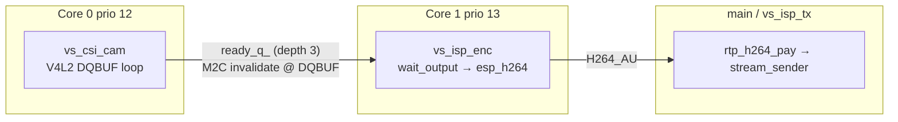

# ESP32-P4 live TX — 1080p30 work log

**Status (Oct 2026):** Goal **not met**. Pipeline is stable on bench (no camera drops, no send WDT) but sustained live TX remains **~28.9 fps** with **`encode_ms` ~33.3–33.5 ms** (avg) and **`wall_ms` / `dq_ms` ~34.7 ms**. Target is **≥30 fps** with UART **`encode_ms` ≤33 ms** steady, verified over **direct LAN UDP** to the GS receiver (no winject on the media path).

## Branches

| Branch | Role |
|--------|------|
| `cursor/p4-latency-wdt-fix-7451` | Earlier latency / WDT / live-TX UART work |
| `cursor/p4-dqbuf-coherency-overlap-7451` | **Current integration branch** — CSI DQBUF coherency overlap, fused ISP source, stats, patches |

Merge `cursor/p4-dqbuf-coherency-overlap-7451` into `cursor/p4-latency-wdt-fix-7451` when ready for a single PR line.

## Bench setup

- **Board:** Waveshare ESP32-P4-WIFI6-DEV-KIT + OV5647 MIPI-CSI
- **IDF:** 5.5.5 (`~/esp/esp-idf-v5.5.5`)
- **Flash:** typically `/dev/ttyACM0`
- **P4 LAN:** DHCP (e.g. `192.168.253.28`)
- **GS receiver:** direct UDP `192.168.253.106:21090` (`CONFIG_VSTREAMER_RX_PEER` in `sdkconfig.defaults`)
- **Media path:** `fec=none`, `max_kbps=0` — **not** through winject/radio for e2e timing

Build and flash:

```bash
. ~/esp/esp-idf-v5.5.5/export.sh
cd idf/example
idf.py set-target esp32p4 build
./apply-patches.sh && idf.py build flash monitor
```

After boot, UART prints boot `bench h264 internal/psram` lines, then periodic `live TX … fps` with `isp` stats.

## Pipeline architecture



**Component:** `esp32_h264_isp_src` fuses `esp32p4_csi_camera_src` + `h264_encoder_esp32p4` (no separate graph nodes).

| Thread | Stack | Core | Priority | Work |
|--------|-------|------|----------|------|
| `vs_csi_cam` | 8 KiB | 0 | 12 | `VIDIOC_DQBUF`, PSRAM cache M2C invalidate, `ready_q_`, `xTaskNotifyGive` to encoder |
| `vs_isp_enc` | 24 KiB | 1 | 13 | `wait_output()` → `push_encoder_input()` → `esp_h264` |
| `vs_isp_tx` (main) | — | — | — | Pull coded AUs, pay, sender; `vTaskDelay(1)` while draining (WDT-safe) |

**Defaults (live TX):** 1920×1080, 30 fps, GOP 30, 4 Mbps, QP 40–51, **6** V4L2 buffers (`REQBUFS` with 8 fails at 1080p).

**sdkconfig:** CPU **400 MHz**, SPIRAM **250 MHz** (`sdkconfig.defaults`).

## CSI → encoder coherency

CSI mmap frames live in **SPIRAM**. Correctness and overlap strategy:

1. **At V4L2 DQBUF** (`esp32p4_csi_camera_src::capture_main`): `esp_cache_msync(..., M2C)` on the frame (64-byte aligned range) so CPU/H.264 DMA see ISP-written YUV.
2. **In `esp_h264_enc_process`** (`esp_h264_psram_dqbuf_coherency.patch`): **skip** PSRAM invalidate when input is external RAM — invalidate already happened at DQBUF so work can overlap the **previous** frame’s HW encode.
3. **Internal RAM** YUV (synthetic bench): still uses writeback in `enc_process`.
4. **`esp_h264_cache_aligned_invalidate.patch`:** aligned invalidate helper in `esp_h264_cache.c`.
5. **`esp_h264_db_bypass.patch`:** HW deblocking filter bypass (`db_bypass = 1`) for a small encode-time win.

Apply all via `./apply-patches.sh` after the first `idf.py build` (patches target `managed_components/espressif__esp_h264`).

**Not viable on this board:** copy full 1080p YUV to **internal** RAM before encode — ~3 MB frame does not fit largest internal block (~417 KB measured).

## UART metrics (how to read)

`live TX` line includes `isp` query `stats`:

| Field | Meaning |
|-------|---------|
| `cam frames` / `dropped` / `dq_ms` | Capture rate, drops when `ready_q_` full, average DQBUF interval |
| `enc frames` / `encode_ms` / `p_avg` / `max` | HW encode count, last, average, **P-frame average**, IDR peak |
| `wall_ms` | Encode thread wall time between completed frames |
| `wait_ms` | Time blocked in `wait_output()` |
| `push_ms` | `push_encoder_input()` (≈ encode + encoder backpressure drain) |

Boot **`bench h264 psram`**: synthetic heap PSRAM YUV, same QP/GOP as live — isolates HW from CSI.

## Authoritative bench results (post-fixes)

| Metric | Typical | Target |
|--------|---------|--------|
| Boot `bench h264 psram` avg | **~32.9 ms** | ≤33 ms |
| Live `encode_ms` / `p_avg` avg | **~33.3–33.4 ms** | ≤33 ms |
| Live `max` (IDR) | **~34.3–34.5 ms** | — |
| `wall_ms` / `dq_ms` | **~34.6–34.7 ms** | ~33.33 ms |
| `wait_ms` | **~0.9–1.2 ms** | — |
| Live TX / enc fps | **~28.8–28.9** | ≥30 |
| `cam dropped` | **0** | 0 |

**Interpretation:** ~**1.3–1.4 ms** per frame over the 33.33 ms budget. Synthetic PSRAM **~32.9 ms** leaves only ~**0.4 ms** headroom before live scene/complexity and **`wait_ms`** push **`wall_ms`** to ~34.7 ms.

**GS e2e:** With `telemetry=on`, UART has shown `peer{rcv=100 lost=0 rej=0}` on direct LAN — packets arrive; UART fps stays encode-limited. Default **`telemetry=off`** → `peer{rcv=0}` is expected.

## Code changes (summary)

### `esp32_h264_isp_src`

- Fused camera + encoder; `encode_main()` on dedicated thread.
- `wall_ms`, `wait_ms`, `push_ms` stats.
- `open()` does not hold ISP mutex across encoder `open()` (deadlock fix).
- `reset_stats` configure hook for clean measurement windows.
- Optional `set_live_tx_hooks()` — bench showed **worse** than separate TX thread; default is split.

### `esp32p4_csi_camera_src`

- `wait_output()` + condition variable (no tight `output()` poll).
- `ready_q_` depth **3** (was single slot).
- `set_wake_task()` + `xTaskNotifyGive` from capture to `vs_isp_enc`.
- `dq_ms` in `stats`.
- **WIP (local):** `VIDIOC_G_PARM` before conditional `VIDIOC_S_PARM` for fps — logs driver `timeperframe` and capability flags.

### `h264_encoder_esp32p4`

- `p_avg` (P-frame average encode time) in stats.
- `configure("reset_stats", "1")`.

### `idf/example/main/main.cpp`

- Live TX uses `h264_isp_src`, `bench_h264_yuv_ram_compare()` at start.
- `drain_pay_to_sender`: **`vTaskDelay(1)`** instead of `taskYIELD()` — fixes **`vs_send` WDT** starvation.
- `telemetry=off` by default for production-style runs.

## `esp_h264` patches (`idf/example/patches/`)

| Patch | Purpose |
|-------|---------|
| `esp_h264_psram_dqbuf_coherency.patch` | Skip PSRAM cache op in `enc_process` when DQBUF already invalidated |
| `esp_h264_psram_invalidate.patch` | Legacy path; `apply-patches.sh` migrates to DQBUF model |
| `esp_h264_cache_aligned_invalidate.patch` | 64-byte aligned invalidate |
| `esp_h264_db_bypass.patch` | HW deblock bypass |
| `esp_h264_aggressive_decimate.patch` | **Not in `apply-patches.sh`** — score 255; tried manually, no sustained 30 fps win |

## Experiments that did **not** close the gap

- DQBUF overlap + skip enc PSRAM cache (helpful but insufficient alone)
- HW `db_bypass`, aggressive MB decimate (255), QP/bitrate sweeps
- ISP pipeline controller off
- CPU affinity swap (encode vs capture) — more drops, higher wall
- In-`open()` CSI mmap encode bench while `vs_csi_cam` running — race, massive `dropped`
- `live_tx_yield()` on send path — WDT; reverted to `vTaskDelay(1)`
- 8 V4L2 buffers — `REQBUFS` **EIO**; keep **6**
- `esp_video` V4L2 H264 M2M — same `esp_h264_enc_process()`, same SPIRAM behavior

## Pitfalls

| Symptom | Cause / fix |
|---------|-------------|
| `vs_send` WDT | Use `vTaskDelay(1)` in pay/sender drain loops |
| `cam dropped` spikes | Do not bench-encode in `open()` while capture thread runs; avoid holding locks across encode input |
| `peer{rcv=0}` | `telemetry=off` — not necessarily packet loss |

## Remaining work (for 1080p30 goal)

1. **~1 ms+** faster live `esp_h264_enc_process` from SPIRAM YUV, or lower non-HW pipeline overhead so **`wall_ms` ≤ 33.33 ms**.
2. UART steady **`encode_ms` avg ≤33 ms** and **`live TX` ≥30 fps** on bench.
3. GS verification: depay/render metrics when validating end-to-end (telemetry when peer stats needed).
4. Vendor path: coherent CSI→H.264 DMA, newer `espressif/esp_h264`, or internal/M2M buffer sharing without full-frame internal alloc.

## Key commits on `cursor/p4-dqbuf-coherency-overlap-7451`

(Newest first — partial list)

- `ee6d61a` — task-notify wake for `vs_isp_enc`; `ready_q` depth 3
- `26c7b02` — `open()` lock scope; `reset_stats`
- `ab0e98f` — 2-deep ready queue (later deepened to 3); README timing budget
- `074f2dc` — DQBUF PSRAM coherency overlap, `p_avg`, db_bypass in apply-patches
- `c49bdf4` — aligned PSRAM invalidate; TX wait on EAGAIN
- `f7a534e` — fuse encode with camera pull; `dq_ms`
- `1628503` — six V4L2 buffers
- `c163dfd` — overlap PSRAM invalidate with encode

Earlier base on `cursor/p4-latency-wdt-fix-7451` includes dual-thread ISP, bitstream pool fixes, UART enc fps from query.

## Related files

- `src/components/esp32_h264_isp_src.{hpp,cpp}`
- `src/components/esp32p4_csi_camera_src.{hpp,cpp}`
- `src/components/h264_encoder_esp32p4.{hpp,cpp}`
- `idf/example/main/main.cpp`
- `idf/example/apply-patches.sh`
- `idf/example/README.md` — operator expectations (shorter)
